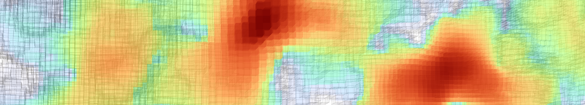
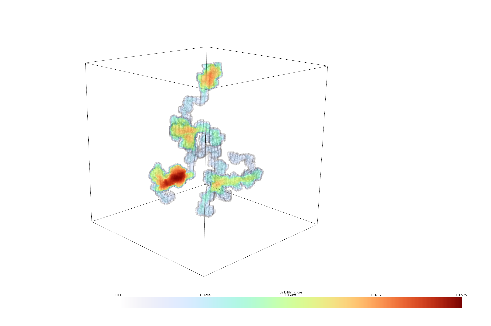
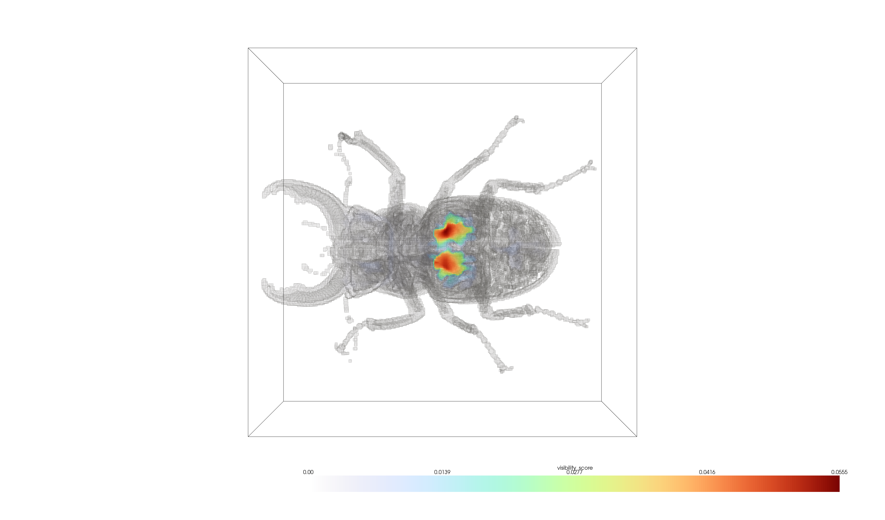
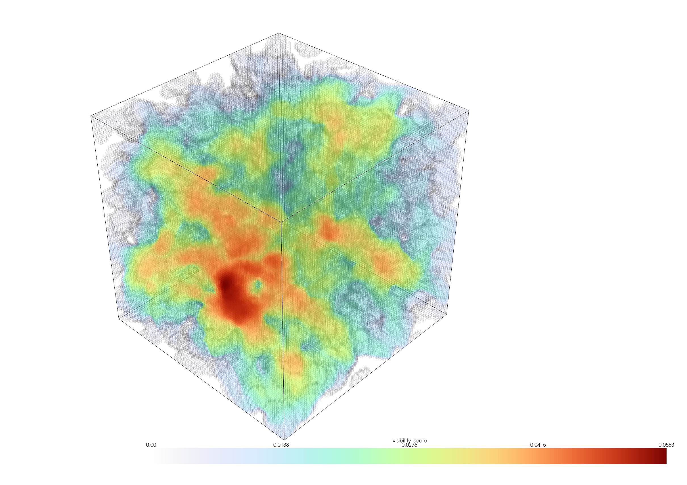
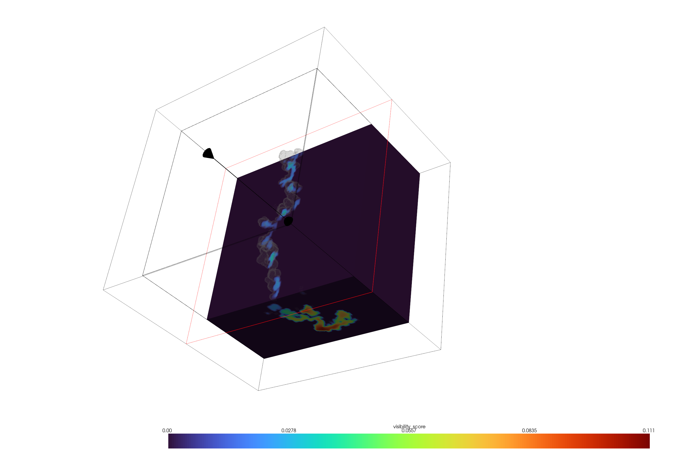

<p align="center">
  
</p>

# seeVol


`seevol` analyses line-of-sight visibility in 3D binary volumes, where 1 represents a solid/opaque voxel, and 0 represents an open/transparent voxel.

The core functionality is based on the Amanatides & Woo voxel traversal algorithm <sup>1</sup> and is implemented in C++ to compute straight line visibility between pairs of open (non solid) voxels in a given volume.  

This tool tests visibility between **all** open pairs throughout the volume, which permits per-voxel visibility analysis metrics to be calculated downstream for every open voxel.

> [!WARNING]
> `seevol` computes all-pairs visibility, which scales as O(open_voxels<sup>2</sup>). This becomes slow or memory-limiting beyond a few hundred thousand open voxels — see [Limitations](#limitations) before running on large volumes. Downsampling the volume is likely to help but will impact results.  

## Requirements

Python 3.10–3.13. Prebuilt wheels are available for Windows, Linux (x86_64), and macOS (Apple Silicon, macOS 26+). Other platforms will build from source and require CMake, a C++17 compiler, and `pybind11`.

## Dependencies

Pyvista is a dependency for visualisations of the visibility metrics output onto the 3D volume itself (see [this visual example](examples/visualiser_example.py) for use).

## Installation

To install seevol:

```bash
pip install seevol
```

or for uv users:

```bash
uv pip install seevol
```

## Usage

The core function `visible_pairs()` accepts a 3D binary (1 = solid, 0 = open) NumPy array as input and outputs two NumPy arrays:

- `coords` — shape (N, 3), the open voxel coordinates in the volume  
- `edges` — shape (M, 2), pairs of indices into `coords` for voxels that are mutually visible  

For example, if `edges[0]` is `[2, 7]`,the visibility edge connects `coords[2]` and `coords[7]` and these two voxels are visible to each other via direct line of sight.  

Users can load .npy files in Python using `np.load()` and pass the result to `visible_pairs()`.  

Downstream analyses or visualisations are then possible from this output, such as visualising a 'visibility heatmap' using Pyvista (see below) 

## Limitations  

This tool currently uses all-pair calculation using voxel ray traversal. Because of this, the ray traversal algorithm scales as O(open_voxels<sup>2</sup>) and is therefore quickly unusable for large volumes.  

A hard limit is imposed in the C++ source file which limits the maximum open voxel count to 1,000,000. In reality, volumes with over 500,000 open voxels are likely to lead to OOM issues on normal computers as very large visible edges will be stored. Methods to reduce this runtime will hopefully be introduced over time.

## Minimal example

The [quickstart example](examples/quickstart.py) creates a small volume of open voxels with one solid voxel blocking visibility:

```python
import numpy as np
import seevol 

# 0 = open, 1 = solid
volume = np.zeros((3, 3, 3), dtype=np.uint8)

# adds an obstruction
volume[1, 1, 1] = 1

# calculate pairwise voxel visibility
coords, edges = seevol.visible_pairs(volume)

print(f"{len(coords)} open voxels containing {len(edges)} visible pairs")
```

It prints the number of open voxels and visible pairs:

```
26 open voxels containing 214 visible pairs
```

### Using .npy files 

> [!IMPORTANT]
> NumPy array volumes as .npy files must be 3D and contain binary values, with 1 = solid and 0 = open voxels.

To import your own 3D NumPy volume and calculate visibility as with the above example:

```python
import numpy as np
import seevol 

# load your own 3D NumPy volume: 1 = solid, 0 = open
volume = np.load("my_volume.npy")

# calculate pairwise voxel visibility
coords, edges = seevol.visible_pairs(volume)

print(f"{len(coords)} open voxels containing {len(edges)} visible pairs")
```

## Visualisation examples on large volumes

#### 1. Artificial 'ant nest'  

Below shows an example output of the visibility score per voxel as a heatmap within an excavated tunnel system in a 150x150x150 volume, generated using `tunnel_excavator()` to mimic an ant-nest structure and visualised with Pyvista using `visibility_visualiser()`:  



#### 2. CT scan of a male stag beetle   

An example using a CT scan of a male stag beetle (raw scan file downloaded from: http://klacansky.com/open-scivis-datasets/)  



#### 3. Artificial porous volume    

A visibility scored volume using a generated 64x64x64 `porespy` volume:



#### 4. Plane slicer on an artificial 'ant nest'     

Using `visibility_visualiser(plane_slicer=True)` on a 180x180x180 volume to see plane slices of visibility scores:  




## References

> 1. Amanatides, J., & Woo, A. (1987, August). A fast voxel traversal algorithm for ray tracing. In Eurographics (Vol. 87, No. 3, pp. 3-10).

