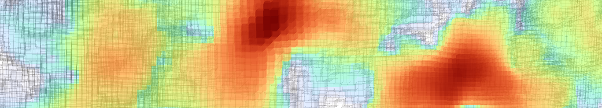
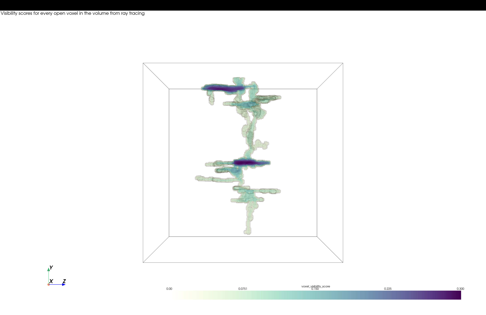
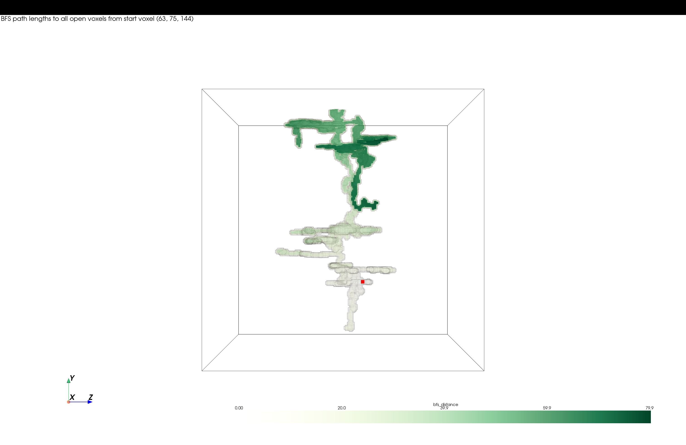
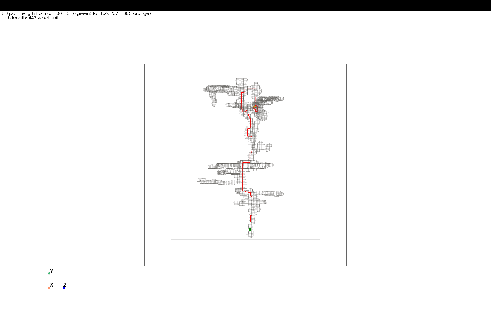

<p align="center">
  
</p>

# seeVol


`seevol` is a network analysis toolkit for working with binary 3D volumes, where 1 represents a solid/opaque voxel, and 0 represents an open/transparent voxel in the volume. There are currently two main aspects being developed for analysis: spatial (physical connectivity) and visibility (line-of-sight connectivity).

### Spatial analysis

BFS [TODO]

### Visibility analysis

Visibility aspect of seevol analyses line-of-sight visibility across open areas of the volume.

The core functionality is based on the Amanatides & Woo voxel traversal algorithm <sup>1</sup> and is implemented in C++ to compute straight line visibility between pairs of open (non solid) voxels in a given volume.  

This tool tests visibility between **all** open pairs throughout the volume, which permits per-voxel visibility analysis metrics to be calculated downstream for every open voxel.

Please note: this involves computing all-pairs visibility, which scales as O(open_voxels<sup>2</sup>). This becomes slow or memory-limiting beyond a few hundred thousand open voxels — see Limitations section before running on large volumes. Downsampling the volume is likely to help but will impact results.  

## Requirements

Python 3.10–3.13. Prebuilt wheels are available for Windows, Linux (x86_64), and macOS (Apple Silicon, macOS 26+). Other platforms will build from source and require CMake, a C++17 compiler, and `pybind11`.

## Dependencies

Pyvista is a dependency for visualisations of the visibility metrics output onto the 3D volume itself (see [this visual example](examples/visualiser_example.py) for use).

## Installation

To install seevol:

```bash
pip install seevol
```

or for uv users:

```bash
uv pip install seevol
```

## Usage

### Visibility analyses 

The core function `visibility_graph()` accepts a 3D binary (1 = solid, 0 = open) NumPy array as input and outputs two NumPy arrays:

- `coords` — shape (N, 3), the open voxel coordinates in the volume  
- `edges` — shape (M, 2), pairs of indices into `coords` for voxels that are mutually visible  

For example, if `edges[0]` is `[2, 7]`,the visibility edge connects `coords[2]` and `coords[7]` and these two voxels are visible to each other via direct line of sight.  

Users can load .npy files in Python using `np.load()` and pass the result to `visible_pairs()`.  

Downstream analyses or visualisations are then possible from this output, such as visualising a 'visibility heatmap' using Pyvista. Note, if just visualising it is preferred to use `visibility_scores()` over ther graph function, as this is much smaller in memory use but won't allow graph analysis calculations.

### Spatial analyses

BFS [TODO]

## Limitations  

This tool currently uses all-pair calculation using voxel ray traversal. Because of this, the ray traversal algorithm scales as O(open_voxels<sup>2</sup>) and is therefore quickly unusable for large volumes.  

A hard limit is imposed in the C++ source file which limits the maximum open voxel count to 500,000. In reality, volumes with over 250,000 open voxels are likely to lead to OOM issues on normal computers as very large visible edges will be stored. Methods to reduce this runtime will hopefully be introduced over time.

## Minimal example

The [quickstart example](examples/quickstart.py) creates a small volume of open voxels with one solid voxel blocking visibility:

```python
import numpy as np
import seevol

# 0 = open, 1 = solid
volume = np.zeros((3, 3, 3), dtype=np.uint8)

# adds an obstruction
volume[1, 1, 1] = 1

# calculate pairwise voxel visibility
coords, edges = seevol.visible_pairs(volume)

print(f"{len(coords)} open voxels containing {len(edges)} visible pairs")
```

It prints the number of open voxels and visible pairs:

```
26 open voxels containing 214 visible pairs
```

### Using .npy files 

NumPy array volumes as .npy files must be 3D and contain binary values, with 1 = solid and 0 = open voxels.

To import your own 3D NumPy volume and calculate visibility as with the above example:

```python
import numpy as np
import seevol

# load your own 3D NumPy volume: 1 = solid, 0 = open
volume = np.load("my_volume.npy")

# calculate pairwise voxel visibility
coords, edges = seevol.visibility_graph(volume)

print(f"{len(coords)} open voxels containing {len(edges)} visible pairs")
```

## Visualisation examples on large volumes

Below examples are shown on an example 300x300x300 volume, generated using `tunnel_excavator()` to mimic an ant-nest structure and visualised with Pyvista.  

#### 1. Visibility scores

- Heatmap of line-of-sight visibility between nodes using `visibility_vis()`:   



#### 2. BFS (all node)

- Heatmap of BFS distances from a starting node to all other nodes within the structure using `bfs_all_vis()`:




#### 3. BFS (shortest distance)

- BFS path of shortest distance between a start and an end node within the structure using `bfs_shortest_vis()`: 




## References

> 1. Amanatides, J., & Woo, A. (1987, August). A fast voxel traversal algorithm for ray tracing. In Eurographics (Vol. 87, No. 3, pp. 3-10).

